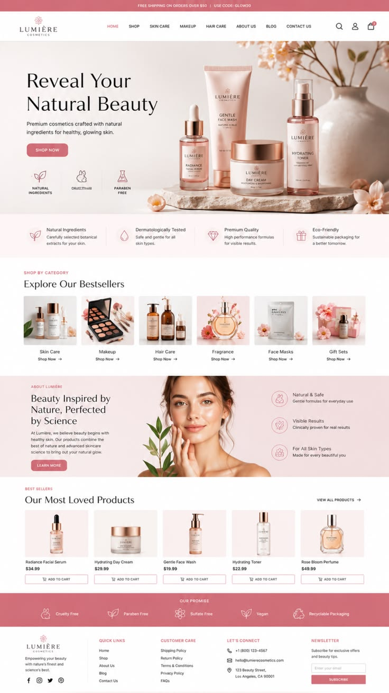

# ROSEVEIL Cosmetics — Design Rationale

## 1. My Design Inspiration

When I started working on ROSEVEIL, I wanted to create a cosmetics website that looked elegant, soft, and modern.

I found a design on Pinterest called **LUMIÈRE Cosmetics**. I liked its clean layout, soft pink colors, product photography, and the way the sections were organized.

I used this design as my starting reference, but I wanted to create my own version rather than copy everything exactly.

I kept some of the general layout ideas and developed them with my own branding, colors, fonts, product images, animations, and shopping features.

**Original reference:** LUMIÈRE Cosmetics — Pinterest design inspiration.

## 2. My Brand Identity

I chose the name **ROSEVEIL Cosmetics** because I wanted a beauty brand that felt feminine, elegant, and a little luxurious.

I changed the original colors and used my **Rose Dusk** palette. My main colors are soft pink, blush, dusty rose, and warm beige, with darker burgundy and rose-gold accents.

I also created two different themes:

- **Light theme:** Soft pink and beige backgrounds with rose-colored details.
- **Dark theme:** Deep burgundy colors with lighter text and rose-gold accents.

For the typography, I used **Cormorant Garamond** for headings and **DM Sans** for smaller text, buttons, and navigation.

I changed the brand name, logo, product images, and packaging presentation to make everything feel consistent with ROSEVEIL.

## 3. What I Changed and Improved

### Hero Section

The hero section is one of my favorite parts of the website.

The original reference showed cosmetics products in a beautiful static scene. I liked that idea, but I wanted to make my hero more interesting.

I created a different composition using a warm beige background, a marble platform, flowers, a vase, and ROSEVEIL products.

I also added animations so the products enter the scene one after another and then settle into their positions.

I adjusted the text and product placement for smaller screens, and I kept a static version for users who prefer reduced motion or when the animation cannot load.

### Product Categories

I kept the idea of showing product categories with images because it makes the website easier to explore.

However, I changed the images, spacing, and card shapes to match my brand.

The website has seven categories, including Skin Care, Makeup, Hair Care, Fragrance, Body Care, Face Masks, and Gift Sets.

I used rounded corners and soft colors to give this section a different look from the original reference.

### About Section

In the reference design, the About section included a model's photograph.

I decided to use a ROSEVEIL gift box with beauty products instead because I wanted the section to focus more on my brand and its packaging.

I also changed the text, icons, colors, and layout to create a softer presentation.

### Product Collection

I wanted the product collection to look attractive but also be easy to use.

I redesigned the product cards with rounded corners, soft backgrounds, and pink Add to Bag buttons.

I also added interactive features such as product search, category filtering, price sorting, and product details.

The catalog contains 30 products across seven categories.

### Shopping Bag

I worked on the shopping bag to make it more useful and consistent with the website.

Users can add products, change quantities, remove items, clear the bag, and use the GLOW20 discount code.

I adjusted the layout, buttons, spacing, and colors so the shopping experience feels connected to the rest of ROSEVEIL.

### Footer

I also redesigned the footer.

I reorganized the navigation links, customer-care information, contact details, and newsletter area.

I reduced unnecessary spacing and made the layout more compact, especially on smaller screens.

## 4. Responsive Design

I wanted ROSEVEIL to work on both mobile and larger screens.

I used mobile-first CSS and adjusted the navigation, hero, category cards, product grid, and footer for different screen sizes.

On mobile, the categories and product cards appear in fewer columns. On larger screens, more items can appear side by side.

I also paid attention to input labels, keyboard navigation, visible focus, and the Escape key for closing search controls.

My goal was to keep the website comfortable to use without losing its visual style.

## 5. How My Design Is Different from the Reference

The Pinterest design helped me choose the general direction, but I made several changes to create my own version.

| Element        | My Changes in ROSEVEIL                                         |
| -------------- | -------------------------------------------------------------- |
| Branding       | Changed LUMIÈRE to my own ROSEVEIL identity and logo.          |
| Colors         | Created the Rose Dusk palette and added a burgundy dark theme. |
| Typography     | Changed the fonts and text styling.                            |
| Product images | Used different cosmetics products and packaging designs.       |
| Hero           | Created a new scene and added animated product layers.         |
| Categories     | Updated the images, spacing, and rounded card shapes.          |
| About section  | Replaced the model image with a ROSEVEIL gift box.             |
| Product cards  | Redesigned the cards and added interactive shopping controls.  |
| Shopping bag   | Improved the layout and added cart management features.        |
| Footer         | Reorganized the content and improved the responsive layout.    |

I kept some of the original structure because I liked how it guided the user through the website. However, the final colors, product presentation, animations, and details reflect the direction I chose for ROSEVEIL.

## 6. Testing My Design

While developing the website, I checked the design in my local browser and made changes when something did not look or work correctly.

For example, I noticed that the collection search panel was covering the product cards. I investigated the issue, tried a manual fix, and then used Codex to help complete the layout correction.

I also improved the header search so it closes when pressing Escape, clicking outside, or submitting a search.

I used these commands to help check the project:

- `npm run typecheck`
- `npm run lint`
- `npm test`
- `npm run build`
- `npm run format:check`

Automated tests help me check the code, but I also learned that I need to review visual changes in the browser.

## 7. Final Result

My goal was to turn a Pinterest design reference into my own cosmetics website.

I kept the elegant feeling and some of the original layout ideas, but I changed the branding, colors, typography, product presentation, and several sections.

I also added animations and interactive shopping features to make the website more engaging.

I am happy with how ROSEVEIL developed because it now has a more personal identity and reflects the style I wanted to create.
