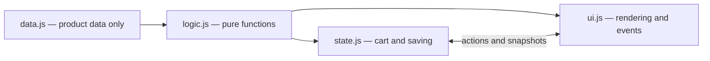

# ROSEVEIL architecture

Four boxes contain the implementation; `main.js` connects them and imports the styles.

Arrows show data flow. Imports are one-way: logic imports data; state imports logic; UI imports logic. Main creates state and passes it to `initializeUI(state)`.

## Function ownership

| Box      | Functions and responsibilities                                                                                                                                                                                                                                                                                                                                                                                                   |
| -------- | -------------------------------------------------------------------------------------------------------------------------------------------------------------------------------------------------------------------------------------------------------------------------------------------------------------------------------------------------------------------------------------------------------------------------------- |
| data.js  | `products` only; no functions. Add products here.                                                                                                                                                                                                                                                                                                                                                                                |
| logic.js | `productById`, `formatMoney`, `normalizeCart`, `cartTotals`, `findProducts`; derives `productCategories`. No DOM/storage or mutation of inputs.                                                                                                                                                                                                                                                                                  |
| state.js | `browserStorage`, `createState`, private `saveCart`; actions `addProduct`, `changeQuantity`, `removeProduct`, `setPromoCode`, `clearCart`, `setProfile`, `setTheme`; defensive getters for cart, code, profile and theme.                                                                                                                                                                                                        |
| ui.js    | `initializeUI`, `initializeTheme` and its presentation helper `apply`; `$`, `icon`, `escape`, `productMedia`, `notify`, `renderCartCount`, `openContent`, `renderProducts`, `resetFilters`, `addProduct`, `showProduct`, `renderCart`, `showCart`, `showCheckout`, `showAccount`, `continueShopping`, `showContact`, `updateSearch`, `closeMenu`, plus DOM event callbacks. Calls state actions instead of editing cart entries. |

`main.js` performs only composition: imports CSS, calls `createState()`, then `initializeUI(state)`.

## Rules for another team

1. New product? Edit `data.js`.
2. Calculation/search/sort? Add a pure function in `logic.js`, return fresh results, and leave the input catalog unchanged.
3. Cart/profile/theme change or persistence? Add an action to `state.js`. Never edit a cart snapshot in the UI.
4. DOM query, listener, form, dialog or theme styling? Use `ui.js`. Never access storage there.
5. Keep the cosmetics layout, image references, native validation and keyboard behavior intact.
6. Verify with `npm run build` and `node --test tests/*.test.js`.

Both `AGENTS.md` and `CLAUDE.md` record the same boundaries so either coding assistant follows the assignment. Existing storage keys and legacy bag migration remain supported. Demo profiles are still session-only.

## Legacy counter compatibility

`src/counter.js` preserves the original `setupCounter` export by forwarding it from `ui.js`. The unchanged demo implementation now lives exclusively in the UI box, is not called during storefront startup, and has a compatibility test. Theme presentation also has an `updateTheme` helper; it paints the latest state after deferred browser transitions.
