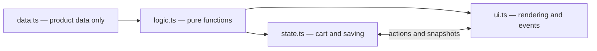

# ROSEVEIL architecture

Four boxes contain the implementation; `main.ts` connects them and imports the styles.

Arrows show data flow. Imports are one-way: logic imports data; state imports logic; UI imports logic. Main creates state and passes it to `initializeUI(state)`.

## Function ownership

| Box      | Functions and responsibilities                                                                                                                                                                                                                                                                                                                                                                                                   |
| -------- | -------------------------------------------------------------------------------------------------------------------------------------------------------------------------------------------------------------------------------------------------------------------------------------------------------------------------------------------------------------------------------------------------------------------------------- |
| data.ts  | `products` only; no functions. Add products here.                                                                                                                                                                                                                                                                                                                                                                                |
| logic.ts | `productById`, `formatMoney`, `normalizeCart`, `cartTotals`, `findProducts`; derives `productCategories`. No DOM/storage or mutation of inputs.                                                                                                                                                                                                                                                                                  |
| state.ts | `browserStorage`, `createState`, private `saveCart`; actions `addProduct`, `changeQuantity`, `removeProduct`, `setPromoCode`, `clearCart`, `setProfile`, `setTheme`; defensive getters for cart, code, profile and theme.                                                                                                                                                                                                        |
| ui.ts    | `initializeUI`, `initializeTheme` and its presentation helper `apply`; `$`, `icon`, `escape`, `productMedia`, `notify`, `renderCartCount`, `openContent`, `renderProducts`, `resetFilters`, `addProduct`, `showProduct`, `renderCart`, `showCart`, `showCheckout`, `showAccount`, `continueShopping`, `showContact`, `updateSearch`, `closeMenu`, plus DOM event callbacks. Calls state actions instead of editing cart entries. |

`main.ts` performs only composition: imports CSS, calls `createState()`, then `initializeUI(state)`.

`initializeHeroEntrance` belongs to the UI box. It waits for all decorative layer images to load, then swaps the static hero for the layered scene. An IntersectionObserver starts one staggered entrance when 12% of the artwork becomes visible and rearms only after it fully leaves the viewport. Reduced motion, image failures and unsupported browsers retain the static image. No scroll listener or business state is involved.

## Rules for another team

1. New product? Edit `data.ts`.
2. Calculation/search/sort? Add a pure function to the appropriate logic module, return fresh results, and leave the input catalog unchanged. Export public functions through `logic.ts`.
3. Cart/profile/theme change or persistence? Add an action to `state.ts`. Never edit a cart snapshot in the UI.
4. DOM query, listener, form, dialog or theme styling? Use `ui.ts`. Never access storage there.
5. Keep the cosmetics layout, image references, native validation and keyboard behavior intact.
6. Verify with `npm run build` and `node --test tests/*.test.js`.

Both `AGENTS.md` and `CLAUDE.md` record the same boundaries so either coding assistant follows the assignment. Existing storage keys and legacy bag migration remain supported. Demo profiles are still session-only.

## Legacy counter compatibility

`src/counter.ts` preserves the original `setupCounter` export by forwarding it from `ui.ts`. The unchanged demo implementation now lives exclusively in the UI box, is not called during storefront startup, and has a compatibility test. Theme presentation also has an `updateTheme` helper; it paints the latest state after deferred browser transitions.

The initial collection preview shows five catalog products across body care, hair care, skincare, fragrance and makeup. View All expands the complete catalog; search, category and sort controls continue to use the full catalog.

## TypeScript contracts

The logic box is split by responsibility while `logic.ts` remains its public entry point:

- `src/modules/products/products.logic.ts`: `productById`, `productCategories`, `findProducts`, `isCategory` and `isSortOrder`, plus the private featured IDs. Reads the catalog from `data.ts`.
- `src/modules/cart/cart.logic.ts`: `normalizeCart`, `cartTotals` and private `isUnknownArray`. Uses product lookup from the products logic module to validate IDs and obtain catalog prices.
- `src/logic.ts`: re-exports both modules and keeps the shared `formatMoney` function. Existing UI, state and test imports stay compatible.
- `SortOrder` lives beside `Product` and `Category` in `products.types.ts` and is re-exported through `logic.ts`.

Both modules belong to the existing pure logic box: no DOM, storage, browser globals or input mutation. Imports flow from cart logic to products logic to data, with no imports back into the public entry point.

Product and Category live in src/modules/products/products.types.ts; CartItem, Cart and CartTotals live in src/modules/cart/cart.types.ts. Theme, Profile, StorageAdapter and AppState live in src/modules/state/state.types.ts. AppState is derived from createState so its action signatures stay synchronized.

Storage JSON enters as unknown and is validated before use. UI helpers check element constructors at runtime and use generic narrowing instead of assertions. Category and sorting values are validated before updating filters. All source modules use TypeScript; Node 24 runs the tests with native type stripping. The catalog event harness strips types with node:module before running the actual UI in its existing VM.

Run `npm run typecheck`, `npm run build`, `npm test` and `npm run lint`. The lint command runs `eslint .` followed by `npm run typecheck`. ESLint checks all 13 current TypeScript source files through `src/**/*.ts` using `@typescript-eslint/parser` and `@typescript-eslint/eslint-plugin`, as well as JavaScript tooling/tests. Typecheck runs `tsc --noEmit` for strict compiler checks.
