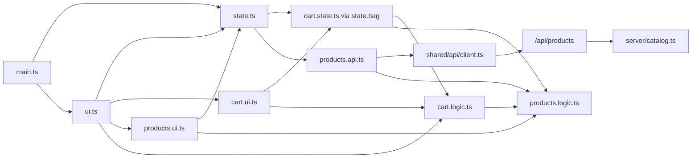

# ROSEVEIL architecture

The server owns the 30 products. Browser modules consume the API; no frontend module imports the server catalog. Main imports styles, creates application state and passes it into the UI.

Arrows show dependencies or calls. Application state passes a current-catalog callback to the cart factory; the cart never imports application state. Type-only contracts are erased at runtime.

## Responsibilities

| File                                   | Ownership                                                                                                                      |
| -------------------------------------- | ------------------------------------------------------------------------------------------------------------------------------ |
| server/catalog.ts                      | Sole maintained product data source.                                                                                           |
| api/products.ts                        | Vercel production API, backed by that catalog.                                                                                 |
| server/products-api.js                 | Vite development/preview middleware; simulations only in development.                                                          |
| src/modules/products/products.api.ts   | Fetch and runtime validation through the shared HTTP client.                                                                   |
| src/modules/products/products.logic.ts | Pure lookup, categories, search, featured filtering, sorting and control-value guards.                                         |
| src/modules/cart/cart.logic.ts         | Pure normalization, validation, pricing, GLOW20 discount and shipping totals.                                                  |
| src/modules/cart/cart.state.ts         | Single owner of cart items, promo code, cart actions, defensive getters, persistence and legacy migration.                     |
| src/state.ts                           | Catalog loading/status/error/subscriptions, bag composition, theme persistence and session profile.                            |
| src/ui.ts                              | Shared UI coordinator: helpers, document click/Escape routing, dialogs, general forms, theme, hero and feature initialization. |
| src/main.ts                            | Startup wiring and style imports only.                                                                                         |

Import pure functions directly from the relevant product/cart module. The central src/logic.ts facade was removed. The filtered array in findProducts is already newly allocated by filter, so sorting it does not mutate the input catalog.

## Cart and application state

createCartState(storage, getCatalog) receives the storage adapter and a callback returning the current fetched catalog. It keeps no catalog copy. state.bag is the actual returned object; it is never spread into a snapshot and application state has no forwarding cart methods.

The UI uses state.bag.items, state.bag.promoCode and the bag's addProduct, changeQuantity, removeProduct, setPromoCode and clearCart actions. items returns fresh item objects on every read. Cart calculations remain in cart.logic.ts; no UI or storage belongs there.

Application state resolves browser storage once, passes the adapter to the cart and persists only the theme itself. Cart storage keeps the exact roseveil-shopping-bag-v1 and legacy lumiere-shopping-bag-v1 keys and JSON shape. The current key takes priority. Legacy data is read as a fallback and written to the current key on a cart edit, without deleting the legacy key. Invalid/blocked storage retains the existing in-memory fallback behavior.

Saved items are shape-validated before products arrive. On successful loading, application state calls bag.reconcileCatalog before setting ready and notifying subscribers. Reconciliation reads the current catalog, skips empty catalogs and does not immediately write storage. Loading, failed and empty requests preserve saved selections and promo codes. Prices and checkout are unavailable when there is no loaded catalog. Clear Bag remains available and persists empty items plus an empty promo code, including when the API is unavailable. Quantity limits and demo checkout behavior are unchanged.

Catalog states remain idle/loading/ready/error; ready plus an empty list renders the empty API state. Loading, error/retry, empty and success rendering stays in the UI. Repeated loads while a request is pending are ignored. No fallback catalog is maintained.

## Contracts and boundaries

Product, Category and SortOrder live in products/products.types.ts. CartItem, Cart and CartTotals live in cart/cart.types.ts. Theme, Profile, StorageAdapter and AppState live in state/state.types.ts. AppState is derived from createState so its nested bag contract remains synchronized. Cart state imports StorageAdapter as a type only; it has no runtime dependency on application state. Avoid importing AppState into cart.state.ts. Feature UI may import AppState as a type.

Only state.ts and cart.state.ts own browser persistence. Only ui.ts, modules/products/products.ui.ts and modules/cart/cart.ui.ts touch the DOM. The reserved shared/ui/toast.ts remains empty. Future product behavior belongs in products.logic.ts, cart calculations in cart.logic.ts, cart transitions in cart.state.ts and application coordination in state.ts.

Theme callbacks read current state during deferred transitions. Hero observers, reduced-motion behavior, static fallbacks, product media, responsive styling and native form validation are unchanged. The profile remains session-only.

## Feature UI ownership

products.ui.ts owns filters and the rendered-ID cache, cards, responsive-media calls, product details, search/category/sort controls, catalog status/retry and the single catalog subscription. cart.ui.ts owns counts, bag rendering, add/quantity/remove/Clear Bag feedback, promo forms and demo checkout. Both call existing state and pure logic; neither owns persistence or fetch implementation.

ui.ts creates both features once and injects the same shared helper implementations. shared/ui/ui.types.ts contains only their contracts. Feature modules import neither the coordinator nor each other. The existing shared/ui/toast.ts remains empty.

The coordinator keeps one document click router: product outside-click handling, cart add handling, product/category handling, then shared dialog/info handling. It keeps one Escape coordinator with the existing native-dialog and defaultPrevented guards; product search/tool dismissal precedes mobile-navigation dismissal. Dynamic promo and checkout forms attach handlers after rendering; stable containers attach once. Product UI starts catalog loading once and invokes the coordinator callback after product rendering to refresh cart counts and any open bag. There is no second cart subscription or extra startup product render.

Shared formatMoney, escaping, productMedia, DOM helpers, notifications and openContent remain implemented only in ui.ts. Focus restoration, node reuse, native validation, theme state reads and observer behavior are preserved.

## API and deployment

UI -> state.loadCatalogProducts -> products.api.ts -> shared/api/client.ts -> /api/products. Local Vite middleware and the production Vercel function use the single server catalog. Production simulations remain disabled. No SPA rewrite is needed for hash navigation. Preserve rewriteRelativeImportExtensions in the TypeScript configuration so deployed ESM imports resolve to emitted JavaScript. See [API setup](local-api.md) and [Vercel preparation and incident diagnosis](vercel-deployment.md).

## Verification

Run npm run typecheck, npm run lint, npm run format:check, npm run build and npm test. ESLint includes src/**/\*.ts, server/**/_.ts and api/\**/_.ts. Tests cover cart state in isolation and through the application/UI, legacy migration, blocked storage, live snapshots, all catalog states, search/filter/sort, theme transitions, animations, image integrity and the emitted production API.
